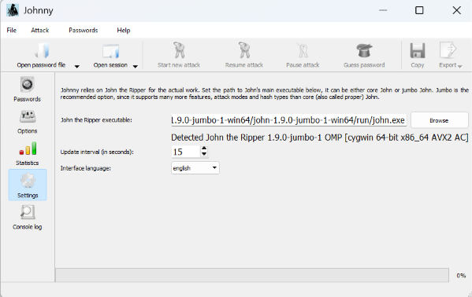

# Password Cracking with John the Ripper (JTR) & Networkwalks Tools

> **Note:** This is for educational purposes only.

---

## Project Overview

This report documents the practical security assessment focused on cryptographic hashing, password-protected file auditing, and dictionary-based password strength testing[cite: 2, 18]. The exercise evaluates how password-protected PDF documents store credential hashes and demonstrates how weak or common passwords can be recovered through offline dictionary attacks using both desktop-based and browser-based auditing utilities[cite: 2, 18].

---

## Objectives

* Recover the passwords of protected PDF files using John the Ripper with Johnny GUI as well as the Networkwalks Hash Calculator and Password Cracker browser tools[cite: 2, 18].
* Understand how password cracking works step by step from hash extraction to matching passwords[cite: 18].
* Recognize why using strong passwords is important for protecting locked files instead of relying on weak or common passwords[cite: 2, 18].

---

## Purpose of the Lab

The purpose of this lab is to demonstrate why relying on short, predictable, or dictionary-based passwords leaves encrypted files vulnerable to offline compromise[cite: 2, 18]. Because encrypted documents store a cryptographic representation (hash) of the access password inside the file metadata, an attacker who obtains the file can extract the hash and test millions of candidate passwords offline without triggering account lockouts or network alerts[cite: 18]. Auditing these mechanisms firsthand reinforces the operational necessity of high-entropy passphrases[cite: 2, 18].

---

## Lab Architecture

* **Local Desktop Stack (Module 1):** Combines the command-line cryptographic engine John the Ripper (`1.9.0-jumbo-1`) with the Johnny GUI (`v2.2`) front-end to parse extracted `$pdf$...` hash text files and run local dictionary attacks[cite: 3, 4, 5, 9, 10].
* **Browser-Based Stack (Module 2):** Uses the Networkwalks Hash Calculator and Networkwalks Password Cracker in a web browser (requiring no installation) to extract the `$pdf$...` hash from a locked PDF and test passwords against a built-in dictionary list[cite: 18, 19, 20, 21].

