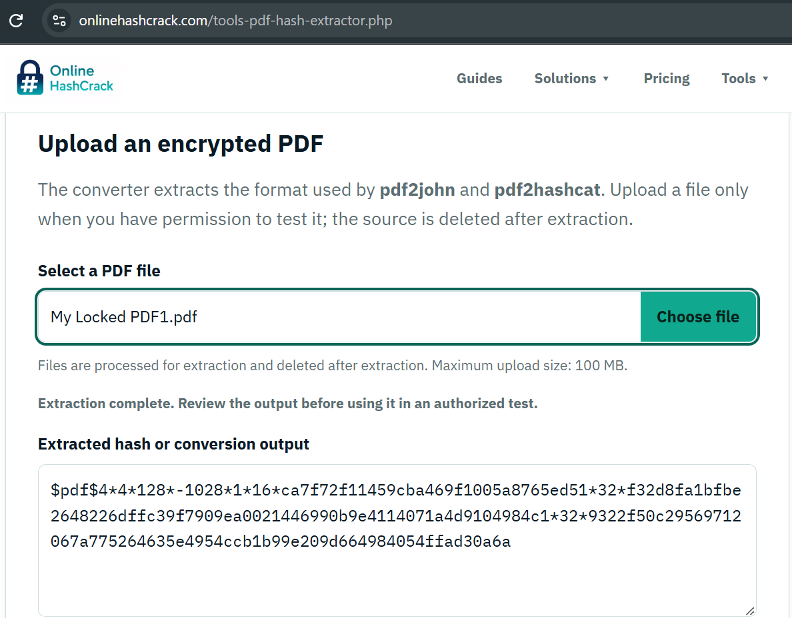
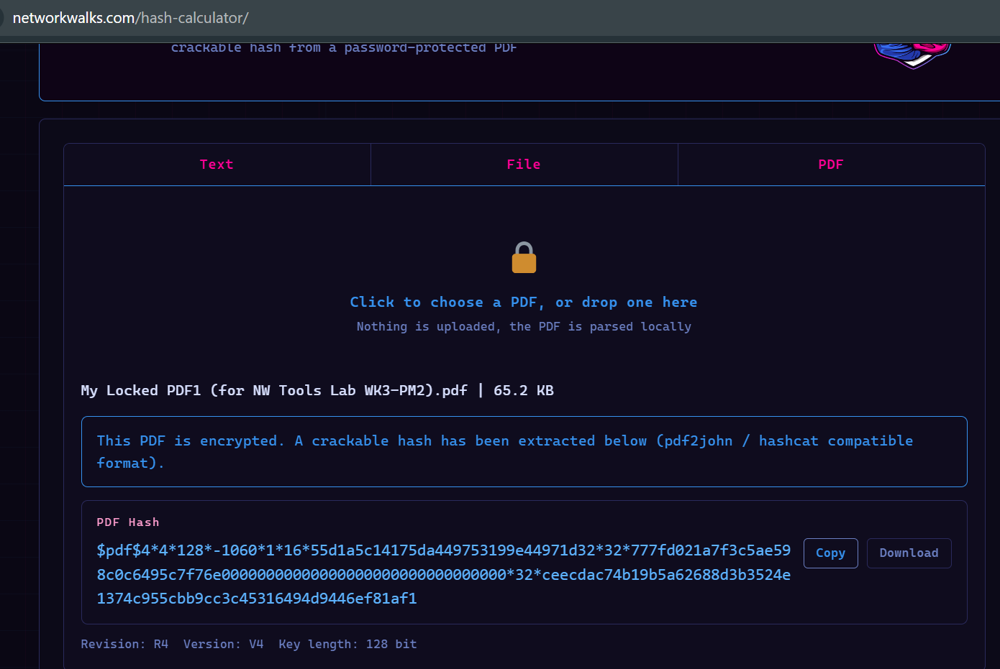

# Password Cracking with John the Ripper (JTR) & Networkwalks Tools

> **Note:** This is for educational purposes only.

## Project Overview

This report documents the practical security assessment focused on cryptographic hashing, password-protected file auditing, and dictionary-based password strength testing. The exercise evaluates how password-protected PDF documents store credential hashes and demonstrates how weak or common passwords can be recovered through offline dictionary attacks using both desktop-based and browser-based auditing utilities.

## Objectives

* Recover the passwords of protected PDF files using John the Ripper with Johnny GUI as well as the Networkwalks Hash Calculator and Password Cracker browser tools.
* Understand how password cracking works step by step from hash extraction to matching passwords.
* Recognize why using strong passwords is important for protecting locked files instead of relying on weak or common passwords.

## Purpose of the Lab

The purpose of this lab is to demonstrate why relying on short, predictable, or dictionary-based passwords leaves encrypted files vulnerable to offline compromise. Because encrypted documents store a cryptographic representation (hash) of the access password inside the file metadata, an attacker who obtains the file can extract the hash and test millions of candidate passwords offline without triggering account lockouts or network alerts. Auditing these mechanisms firsthand reinforces the operational necessity of high-entropy passphrases.

## Lab Architecture

* **Local Desktop Stack (Module 1):** Combines the command-line cryptographic engine John the Ripper (`1.9.0-jumbo-1`) with the Johnny GUI (`v2.2`) front-end to parse extracted `$pdf$...` hash text files and run local dictionary attacks.
* **Browser-Based Stack (Module 2):** Uses the Networkwalks Hash Calculator and Networkwalks Password Cracker in a web browser (requiring no installation) to extract the `$pdf$...` hash from a locked PDF and test passwords against a built-in dictionary list.

## Lab Configuration

| Component | Specification / Value |
| :--- | :--- |
| **Host Operating System** | Windows 11 PC (64-bit) |
| **CLI Cracking Engine** | John the Ripper `1.9.0-jumbo-1` (64-bit Windows binaries, `run/john.exe`) |
| **GUI Front-End** | Johnny GUI `v2.2` (`johnnyInstaller.exe`) |
| **Browser Auditing Suite** | Networkwalks Hash Calculator & Password Cracker (`networkwalks.com`) |
| **Target Artifacts** | `My Locked PDF1.pdf` (65.2 KB, Revision R4, Version V4, 128-bit encryption), `My Locked PDF 2`, `My Locked PDF 3` |
| **Extracted Hash Files** | `Hashmylockedpdf1`, `Hashmylockedpdf2`, `Hashmylockedpdf3` |
| **Attack Methodology** | Offline Dictionary Attack (Built-in 100-word list / JTR default wordlist) |

## Lab Procedure

### Phase 1: Local Desktop Environment (John the Ripper & Johnny GUI)

1. **Engine Deployment:** Downloaded the 64-bit Windows binaries for John the Ripper (`1.9.0-jumbo-1`) and extracted the archive to access the `run` directory containing `john.exe`.
2. **GUI Installation & Linking:** Installed Johnny GUI (`v2.2`), opened **Settings**, and mapped the **John the Ripper executable** path to `john.exe`, verifying active detection (`Detected John the Ripper 1.9.0-jumbo-1`).

   

3. **Hash Extraction & Formatting:** Extracted the cryptographic hash string from `My Locked PDF1` using a PDF Hash Extractor and saved it as a plain text file (`Hashmylockedpdf1`). If the string includes extra characters like `b'` at the very beginning, remove them so the hash starts strictly with `$pdf$`.

   

4. **Password Auditing & Verification (`My Locked PDF1`):** Opened Johnny, navigated to **Open password file > Open password file (PASSWD format)**, selected `Hashmylockedpdf1`, and executed the audit to reveal the password as `good-luck`, which opened `My Locked PDF1` to capture the flag: `nw{cybersecurity_flag_captured_2608}`.

   

   

### Phase 2: Browser-Based Environment (Networkwalks Tools)

1. **Hash Extraction:** Opened the Networkwalks Hash Calculator, uploaded `My Locked PDF1` (for NW Tools Lab WK3-PM2), and copied the extracted hash.

   

2. **Dictionary Execution:** Pasted the hash into the Networkwalks Password Cracker and clicked **Start Cracking**. `password1` opened the file to capture the flag: `nw{networkwalks_flag1_jtr_270521_1}`.

   

   

